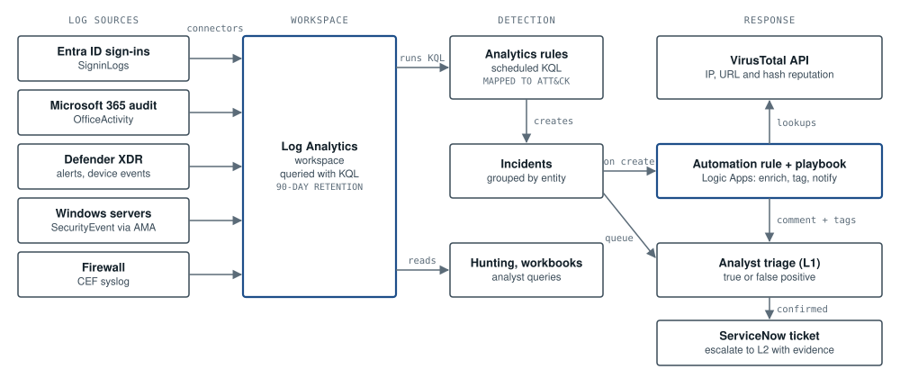

# ARC-01: Microsoft Sentinel SOC architecture

**Tools:** Microsoft Sentinel · Log Analytics · Azure Monitor Agent · Logic Apps · ServiceNow  

*Logs from five sources land in one Log Analytics workspace. Scheduled KQL rules turn matches into incidents, an automation rule runs the enrichment playbook, and the analyst starts triage with reputation data already on the incident. Confirmed incidents go to ServiceNow and Level 2.*

## Key decisions

- One workspace for every source, so one KQL query can join sign-ins, mail and endpoint data.
- Every analytics rule is mapped to MITRE ATT&CK, which shows coverage gaps by tactic.
- Automation enriches and tags incidents but never closes them. People decide outcomes.
- 90 days of searchable data for investigations; older logs move to cheaper archive storage for audit.

## Where it connects

- The detection rules in SOC-01 and the enrichment playbook in SOC-02 run on this design in my lab.
- Firewall logs arrive from the segmented network in ARC-03.
- User-reported phishing from ARC-04 lands here as incidents.

## Code

The detection rules, hunting queries and playbooks for this design are in [ArchiRose/sentinel-soc-automation](https://github.com/ArchiRose/sentinel-soc-automation).

---

Reference design by Archi Rose Mani. Part of the portfolio at [archirose.github.io](https://archirose.github.io). Back to the [index](../README.md).
