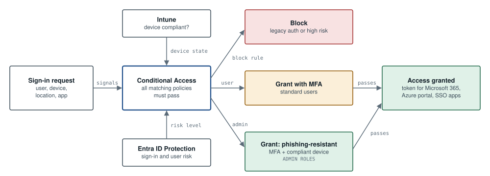

# ARC-02: Zero Trust sign-in with Conditional Access

**Tools:** Entra ID · Conditional Access · Intune · Entra ID Protection  

*Every sign-in sends its signals to Conditional Access, which also asks Intune about the device and Entra ID Protection about risk. All matching policies must pass and a block always wins. Standard users get MFA; admins need phishing-resistant MFA on a compliant device.*

## Key decisions

- Each new policy runs in report-only mode for a week before it is switched on.
- Two break-glass accounts sit outside every policy, with an alert on any use.
- Admins sign in with phishing-resistant methods, because an ordinary MFA prompt can be relayed by a proxy phishing page (see ATK-01).

## Policy set

| Policy | Applies to | Control |
|---|---|---|
| CA01 Block legacy authentication | All users | Block |
| CA02 Require MFA | All users, all cloud apps | Grant: MFA |
| CA03 Phishing-resistant MFA for admins | Admin directory roles | Grant: authentication strength (FIDO2 key or Windows Hello) |
| CA04 Block high-risk sign-ins | All users | Block (Entra ID Protection risk) |
| CA05 Admin portals from compliant devices | Admin directory roles | Grant: compliant device |
| Break-glass accounts | Two cloud-only accounts | Excluded from every policy; any sign-in alerts the SOC |

---

Reference design by Archi Rose Mani. Part of the portfolio at [archirose.github.io](https://archirose.github.io). Back to the [index](../README.md).
