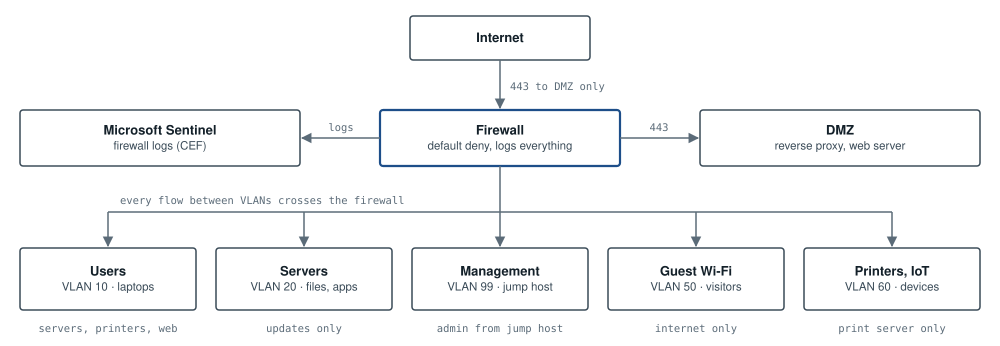

# ARC-03: Network segmentation for a small office

**Tools:** Next-generation firewall · VLANs · jump host · Microsoft Sentinel  

*The five internal VLANs never talk to each other directly. Every flow crosses the firewall, which denies by default, allows only the flows in the matrix below, and sends its logs to Sentinel. From the internet, only HTTPS to the DMZ gets in.*

## Firewall rule matrix

| From \ To | Users | Servers | Management | Guest | IoT | DMZ | Internet |
|---|---|---|---|---|---|---|---|
| Users | — | Allow 443, 445 | Deny | Deny | Allow print 9100, 631 | Allow 443 | Allow via web filter |
| Servers | Deny | — | Deny | Deny | Deny | Deny | Allow update list |
| Management | Allow 3389, 22 from jump host | Allow 3389, 22 from jump host | — | Deny | Allow 443 from jump host | Allow 22 from jump host | Allow update list |
| Guest Wi-Fi | Deny | Deny | Deny | — | Deny | Deny | Allow |
| Printers, IoT | Deny | Allow print server only | Deny | Deny | — | Deny | Allow vendor updates |
| DMZ | Deny | Allow 8443 to app server | Deny | Deny | Deny | — | Deny |

The firewall is stateful, so replies to allowed connections are permitted. Every allow rule has an owner and a reason, and the rules are reviewed every quarter.

---

Reference design by Archi Rose Mani. Part of the portfolio at [archirose.github.io](https://archirose.github.io). Back to the [index](../README.md).
