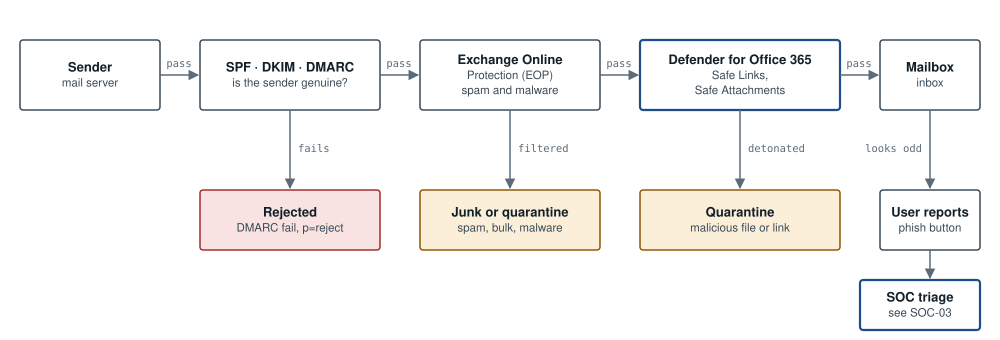

# ARC-04: Email security layers

**Tools:** DNS (SPF, DKIM, DMARC) · Exchange Online Protection · Defender for Office 365  



*Inbound mail passes three layers in order. A DMARC failure is rejected at the edge, Exchange Online Protection filters spam and known malware, and Defender for Office 365 opens attachments in a sandbox and checks links at click time. Anything that still reaches a user can be reported straight to the SOC.*

## Our own domain

- SPF lists every service allowed to send as us, ending in -all.
- DKIM signing is switched on for the domain in Microsoft 365.
- DMARC starts at p=none for four weeks while aggregate reports show every legitimate sender, then moves to p=quarantine and finally p=reject.

## DNS records (example.co.uk)

```text
example.co.uk.         TXT  "v=spf1 include:spf.protection.outlook.com -all"
_dmarc.example.co.uk.  TXT  "v=DMARC1; p=reject; rua=mailto:dmarc-reports@example.co.uk"
```

---

Reference design by Archi Rose Mani. Part of the portfolio at [archirose.github.io](https://archirose.github.io). Back to the [index](../README.md).
