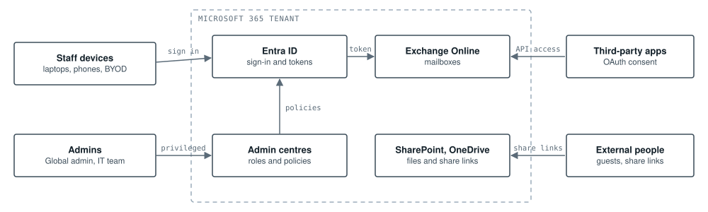

# TM-01: Small business Microsoft 365 tenant (threat model)

**Scope:** A 50-person firm on Microsoft 365: mail, files, Teams and a few third-party apps  
**Method:** STRIDE per trust-boundary crossing  

*Four flows cross the tenant boundary: staff signing in, admins using privileged access, third-party apps granted API access to mail, and files shared with people outside the company. Each crossing is where the threats in the table apply.*

## Threats and mitigations

| STRIDE | Threat | Risk | Mitigations |
|---|---|---|---|
| Spoofing | Password spray or proxy phishing takes over a staff account | High | MFA for everyone and phishing-resistant MFA for admins; legacy auth blocked; risky sign-ins blocked (ARC-02) |
| Tampering | Attacker adds an inbox rule to hide and forward finance email | High | External auto-forwarding blocked; alert on new forwarding rules (SOC-01) |
| Repudiation | Admin changes cannot be traced to a person | Medium | Unified audit log on and kept in Sentinel for a year; named admin accounts, no shared logins |
| Information disclosure | 'Anyone' links expose files to the whole internet | Medium | Sharing defaults to specific people; external sharing reviewed monthly; sensitivity labels on finance and HR |
| Denial of service | Email bombing buries a real alert or invoice | Low | Anti-spam thresholds and mail flow rules; staff report floods |
| Elevation of privilege | A user consents to a malicious OAuth app with mail access; standing Global Admin rights | High | User consent off with an admin approval workflow; app permissions reviewed quarterly; just-in-time admin roles (PIM) |

---

Reference design by Archi Rose Mani. Part of the portfolio at [archirose.github.io](https://archirose.github.io). Back to the [index](../README.md).
