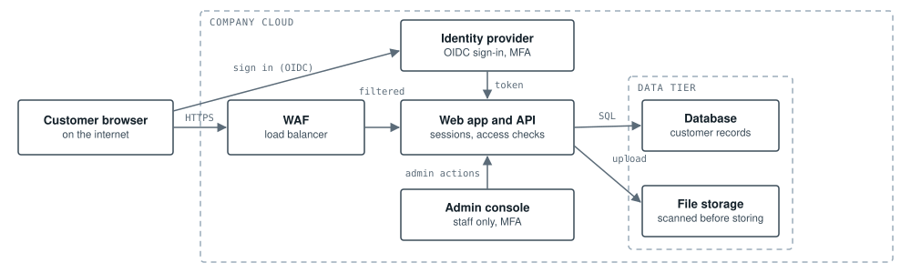

# TM-02: Customer file-upload portal (threat model)

**Scope:** A web portal where customers sign in, upload documents and download their own files  
**Method:** STRIDE per component, with OWASP Top 10 in mind  

*Customer traffic crosses the internet boundary once, through the WAF. The web app is the only component that talks to the database and file storage, and every upload is scanned before it is stored.*

## Threats and mitigations

| STRIDE | Threat | Risk | Mitigations |
|---|---|---|---|
| Spoofing | Credential stuffing against customer logins | High | Sign-in through the identity provider with MFA; rate limits and breached-password checks |
| Tampering | SQL injection through search or upload fields | High | Parameterised queries; server-side validation; WAF rules as a second layer |
| Repudiation | A customer disputes deleting a file | Medium | Append-only audit log of uploads, downloads and deletes with user, time and IP |
| Information disclosure | Changing a file ID in the URL downloads someone else's file (IDOR) | High | Access check on every object request; random file IDs; short-lived download links |
| Denial of service | Huge or repeated uploads fill storage | Medium | Size limits, per-user quotas and rate limits at the WAF |
| Elevation of privilege | A normal user calls admin endpoints directly | High | Admin console on its own route with a separate role check and MFA; deny by default |

---

Reference design by Archi Rose Mani. Part of the portfolio at [archirose.github.io](https://archirose.github.io). Back to the [index](../README.md).
